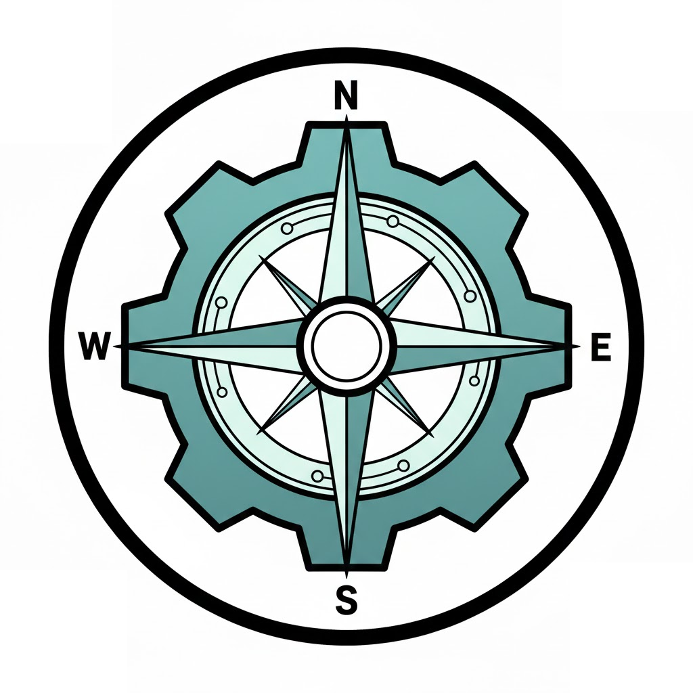
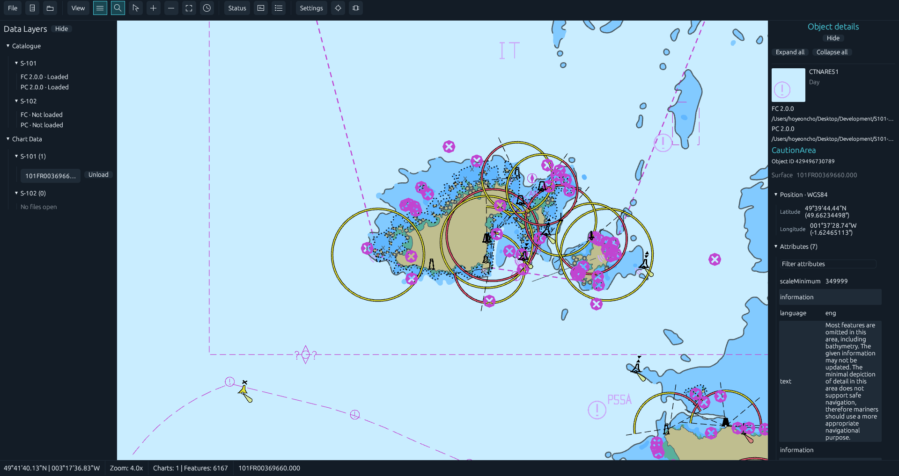

<p align="center">
  
</p>

<h1 align="center">FerriteS100</h1>

<p align="center"><strong>A portable S-100 chart engine and GPU-accelerated viewer written in Rust</strong></p>

<p align="center">
  <a href="https://github.com/SemanticWave-Hoyeon/FerriteS100/actions/workflows/rust.yml"></a>
  
  
  
</p>

FerriteS100 loads IHO S-100 datasets, runs the catalogue-supplied portrayal
rules (Lua and XSLT) and draws the chart with wgpu. The same chart engine runs
in the desktop viewer, a command-line tool, a C library and the browser
(WebAssembly). It handles S-101 electronic navigational charts, S-102
bathymetric surfaces, S-124 navigational warnings, S-129 under keel clearance
plans and S-421 routes.

> **Not for navigation.** This is development and research software, not a
> certified ECDIS. Passing tests do not establish complete S-100, product
> specification or S-98 conformance.

<p align="center"></p>

## Features

| Product | Support |
|---------|---------|
| **S-101** ENC | ISO 8211 base cells and update chains, multiple cells and product editions in one display list, FC/PC-driven Lua portrayal, cancellation history, overscale indication, source-aware object inspection |
| **S-102** bathymetry | 3.0.0 HDF5 with bounded window reads, depth/uncertainty and vertical-reference metadata, independent portrayal catalogue. HDF5 is read by the C library or by a pure-Rust reader (identical results on all test files). EPSG:4326 grids are displayed; UTM/UPS grids are read but not yet drawn |
| **S-124** navigational warnings | 2.0.0 GML with XSLT portrayal, lifecycle (cancellation date, cancellation datasets, in-force bulletins), on chart / off chart / information classification kept per user, NAVWARN list, highlighted areas affected, KML/GPX/shapefile import marked as not official |
| **S-129** under keel clearance | 2.0.0 GML with XSLT portrayal: plan area, planned route through control points, control point information boxes, PlainBoundaries and scaleMinimum controls |
| **S-421** routes | Bounded GML subset import (published 1.0 and a CDV 2.0 subset), route/waypoint inspection, WGS84 rhumb/geodesic legs, minimal published 1.0 export |

Common to all products:

- **Rendering** — GPU points, lines, areas, text and SVG symbols; Day/Dusk/Night palettes; pan and zoom; chart image export without UI (File → Save Chart Image, PNG to the Pictures folder).
- **Datasets** — open a file, a `CATALOG.XML` or a whole folder; exchange sets are discovered recursively and loaded in a worker. S-124/S-129 open as always-on overlays above the ENC. Unsupported or damaged inputs are reported without blocking the others.
- **Validation** — feature catalogue checks for GML products, the S-158-129 checks that a dataset or exchange set allows, and the S-124 dataset and exchange-set rules.
- **Catalogues** — FC/PC pairs are selected per product edition from a local inventory; a newer catalogue never silently converts an older dataset. The shipped S-124/S-129 portrayal catalogues are applied literally by default; *Correct known PC errata* is an opt-in setting.
- **Security** — optional S-100 Part 15 signature verification with OpenSSL or a pure-Rust backend (identical verdicts on all test exchange sets), an `--operational` profile that requires authenticated data, and a sandboxed Lua runtime.
- **S-100 MCP** — a built-in, read-only [Model Context Protocol](docs/S100-MCP.md) server that lets an LLM client query loaded datasets.

## Architecture

The chart engine is separate from any window system or GUI toolkit, so it can
be embedded in different hosts:

```text
                 ┌─ Desktop viewer   ferrite-s100 (winit + egui + ferrite-gpu)
ferrite-engine ──┼─ CLI / library    ferrite-cli  (inspect, validate, render, precompute)
 (chart kernel)  ├─ C ABI            ferrite-capi (include/ferrite.h)
                 └─ Web              ferrite-wasm (wasm-bindgen, WebGPU / WebGL2)
```

`ferrite-engine` exposes a `ChartEngine` facade (open, prepare a scene, pick,
describe features) and platform services (data source, cache store, user store,
clock, executor). Datasets can be opened from files or from bytes in memory,
including signature verification and S-101 update planning. Native-only
dependencies sit behind features, so the engine also builds without OpenSSL,
C HDF5, rayon or a GPU:

| Feature | Default | Without it |
|---------|---------|------------|
| `lua54` / `lua55` | Lua 5.4 | S-101 is drawn from precomputed Part 9a payloads |
| `parallel` | on | Everything runs on the calling thread, same results |
| `s102-hdf5` / `s102-pure` | C HDF5 | Pure-Rust HDF5 reader only (`s102-pure`) |
| `crypto-openssl` / `crypto-rust` | OpenSSL | Pure-Rust X.509/ECDSA backend |

The design, the stages of the split and measurements are in
[docs/ENGINE_DESIGN.md](docs/ENGINE_DESIGN.md).

## Build

Requirements: a current stable Rust toolchain (verified with Rust 1.99), platform C/C++
build tools, and a GPU driver with Metal, Vulkan or DirectX 12. Python 3 is used
only by the build helpers.

```bash
git clone https://github.com/SemanticWave-Hoyeon/FerriteS100.git
cd FerriteS100
python3 tools/package.py --lua 54
```

On macOS this produces `target/release/FerriteS100.app` (catalogues, trust
anchors and icons in `Contents/Resources`); on Windows
`target/release/ferrite-s100.exe` and on Linux `target/release/ferrite-s100`.
The compiler cache stays in `target/package-build`, so later builds only
recompile what changed. `--fast` makes a quicker `release-fast` build for
testing. On Windows use `py -3` instead of `python3`.

The Lua backend is chosen at build time: Lua 5.4 by default, or `--lua 55`.
Exactly one backend must be enabled, so `--all-features` is not supported. A
plain Cargo build is also possible:

```bash
cargo build --locked --profile release-fast --bin ferrite-s100 --no-default-features --features lua54
```

See [BUILDING.md](BUILDING.md) for profiles, input provenance and S-102 storage details.

## Usage

### Desktop viewer

Start the application and use **File → Open Dataset** or **Open Dataset Folder**.
Datasets can also be given on the command line:

```bash
./target/release/ferrite-s100 --chart /path/to/S101-exchange-set
./target/release/ferrite-s100 --chart /path/to/cell.000 --fc /path/to/FC --pc /path/to/PC
./target/release/ferrite-s100 --s102 /path/to/S102-exchange-set
./target/release/ferrite-s100 --overlay /path/to/S-124_or_S-129_folder
./target/release/ferrite-s100 --s421 /path/to/route.gml
```

| Option | Purpose |
|--------|---------|
| `--chart`, `--s102`, `--s421` | Load S-101, S-102 or S-421 input (file or folder) |
| `--overlay` | Load S-124/S-129 GML, an exchange set, or KML/GPX/shapefile imports |
| `--fc`, `--pc`, `--s102-pc` | Use specific catalogues |
| `--catalogue-inventory <dir>` | Local multi-version catalogue inventory (default: `S101-Catalogues` beside the resources) |
| `--center <lat,lon>`, `--zoom <n>` | Initial view |
| `--viewing-date <date>` | Date used for date-dependent portrayal and the S-124 lifecycle |
| `--require-signatures` | Reject unsigned datasets |
| `--operational` | Require authenticated datasets for the whole session |
| `--screenshot <file>` | Render, save an image and exit |

| Input | Action |
|-------|--------|
| Scroll | Zoom |
| Left drag | Pan |
| Left click | Inspect objects (when Object selection mode is on) |
| Esc | Clear the current selection |
| Right click | Reset view |
| F12 | Toggle debug statistics |

The **Data Layers** panel groups loaded catalogues and datasets by product,
where each dataset can be switched on or off or unloaded. **View** opens the
S-124 Navigational Warnings list and the S-129 Under Keel Clearance panel.

### Command line

```bash
cargo build --release -p ferrite-cli          # executable: ferrite
ferrite inspect  [--json] PATH...
ferrite validate [--json] [--verify] PATH...   # exit code 1 on validation errors
ferrite render PATH... --out chart.png [--center LAT,LON] [--zoom Z | --scale N] \
               [--size WxH] [--palette Day|Dusk|Night]
ferrite precompute PATH... --cache-dir DIR     # Part 9a payloads for hosts without Lua
```

### C

`cargo build --release -p ferrite-capi` builds `libferrite` (shared and static)
with the header `crates/ferrite-capi/include/ferrite.h`:

```c
FerriteEngine *e = ferrite_engine_create("Catalogues", NULL, NULL);
ferrite_engine_open_folder(e, "/path/to/S101-exchange-set");
FerriteCamera cam = {1, 49.21, -2.13, 20.0, 0.0};
ferrite_engine_prepare(e, 800, 600, 1.0, &cam);
ferrite_engine_render_rgba(e, rgba, 800 * 600 * 4);
ferrite_engine_destroy(e);
```

A complete example is in `crates/ferrite-capi/examples/c/render.c`.

### Web

`tools/build_wasm.py` builds `ferrite-wasm` for `wasm32-unknown-unknown` with
wasm-bindgen 0.2.108 and writes a demo page outside the repository. In the
browser, S-101 is portrayed with Lua compiled to WebAssembly (output identical
to native), the engine runs in a Web Worker drawing to an OffscreenCanvas, and
per-cell portrayal results are cached in IndexedDB. The Lua build needs a
clang with the WebAssembly target.

```bash
cargo install wasm-bindgen-cli --version 0.2.108 --locked --root /path/tools
python3 -I tools/build_wasm.py --out /path/www --wasm-bindgen /path/tools/bin/wasm-bindgen
python3 -m http.server -d /path/www 8000
```

## Signatures and security

Signature verification is **off by default** so evaluation data can be opened.
Turn it on in Settings or with `--require-signatures`; `--operational` enforces
it for the whole session. Verification uses ECDSA P-384/SHA-384 (and P-256)
against locally installed X.509 trust anchors (`Trust/`). Only the certificates
that signatures actually reference are validated; others listed in the catalogue
are reported and never trusted. The pure-Rust backend rejects the rare cases it
cannot reproduce exactly instead of accepting them.

Lua portrayal runs without the OS, IO and Debug libraries, with file access
confined to the catalogue and per-operation memory/instruction budgets. XSLT
portrayal runs in a bounded, sandboxed processor confined to the catalogue's
rule folder. This is not process isolation. Native plugins must be signed in
release builds.

`ferrite-secom` contains a SECOM receive client under development; it is not an
IEC 63173-2 conformance claim.

## Performance

The renderer caches decoded cells (RAM LRU, 96 MiB), portrayal instructions,
triangulations and static line relations, and coalesces navigation events so
that redundant scene preparation is merged before each frame. Scene rebuilds
after pan and zoom run on a background thread. `FERRITE_NO_CACHE=1` disables the
decoded-cell and instruction caches.

Several experimental optimizations are off by default:
`FERRITE_STATIC_LINE_BOUNDS_CSE=1`, `FERRITE_RETAINED_WORLD_AREAS=1`,
`FERRITE_MOVING_LINE_NORTHING_REUSE=1` and
`FERRITE_LINE_SUPPRESSION_UNCHANGED_TARGETS=1`. `FERRITE_GPU_FRAME_TIMESTAMPS=1`
records GPU timestamps for the chart pass in hidden audits.

## Development

```bash
cargo fmt -- --check
cargo clippy -- -D warnings
cargo test --locked
python3 -I tools/pixel_regression.py   # S-101 renders vs HEAD, pixel by pixel
```

CI builds and tests on macOS, Linux and Windows, checks formatting and Clippy,
and runs a portable job (engine without native dependencies, pure-Rust crypto
tests and the wasm32 build). `tools/pixel_regression.py` builds a base revision
and the working tree outside the repository and compares S-101 renders of fixed
poses (Day/Night, with and without the cell cache).

Test datasets belong in the git-ignored `TestData/` folder. Useful sources:

- [IHO S-100 resources](https://iho-ohi.github.io/S100Resources/) — specifications and catalogues
- [IHO S-129 test datasets](https://github.com/iho-ohi/S-129-Project_Team_Workspace/tree/main/test_datasets)
- [UKHO trial datasets](https://datahub.admiralty.co.uk/portal/home/item.html?id=6966cb7ce9454ccf9afbbd3c9a105f9e)
- [SHOM](https://data.shom.fr/) — public hydrographic data
- [BSH S-102 test data](https://linchart60.bsh.de/chartserver/)
- [NOAA marine navigation developer resources](https://marinenavigation.noaa.gov/developer.html)

```text
src/                          Desktop viewer: event loop, UI orchestration, audits
crates/ferrite-engine/        Chart engine: ChartEngine facade, platform services,
                              dataset opening, scene composition, interoperability
crates/ferrite-cli/           ferrite command-line tool and offscreen rendering
crates/ferrite-capi/          C ABI (libferrite, include/ferrite.h)
crates/ferrite-wasm/          WebAssembly bindings and web demo
crates/ferrite-gpu/           GPU renderer (no windowing or GUI toolkit)
crates/ferrite-ui/            egui panels, winit host and overlay compositing
crates/ferrite-render/        Rendering instructions and geometry
crates/ferrite-s101/          S-101 product module: Lua conversion, product layer (update chains, lifecycle
                              and exchange-set checks, catalogue selection, cell portrayal and caches)
crates/ferrite-s102/          S-102 product module (C and pure-Rust HDF5 readers, product layer)
crates/ferrite-product-api/   Common product module interface (adapters, layers, panel models, platform services, route overlay extension)
crates/ferrite-s100-gml/      Shared GML infrastructure: reader, FC and exchange-set validation, XSLT portrayal input
crates/ferrite-s124/          S-124 product module: lifecycle, imports, rules, per-user state, warning list model
crates/ferrite-s129/          S-129 product module: S-158-129 rules, virtual portrayal features, plan panel model
crates/ferrite-s421/          S-421 product module: route reader/export, product layer (route overlay extension), route editor
crates/ferrite-xslt/          XSLT 1.0 / XPath 1.0 processor for Part 9 portrayal
crates/ferrite-lua/           S-100 Lua host and portrayal rules
crates/ferrite-lua-runtime/   Build-time Lua interpreter selection (native and wasm32)
crates/ferrite-kernel/        Product-independent geometry and geodesy
crates/ferrite-security/      Exchange-set authentication (OpenSSL and pure-Rust backends)
crates/ferrite-mcp/           Built-in S-100 MCP service
crates/ferrite-secom/         SECOM receive client
Catalogues/                   Bundled feature and portrayal catalogues
docs/                         Engine design, MCP service
tools/                        Build, packaging, wasm, pixel regression and parity helpers
```

## License

[PolyForm Noncommercial License 1.0.0](LICENSE).

Developed by [Hoyeon Cho](https://github.com/SemanticWave-Hoyeon) at Korea Maritime
and Ocean University, with standards and catalogue resources from the IHO.
